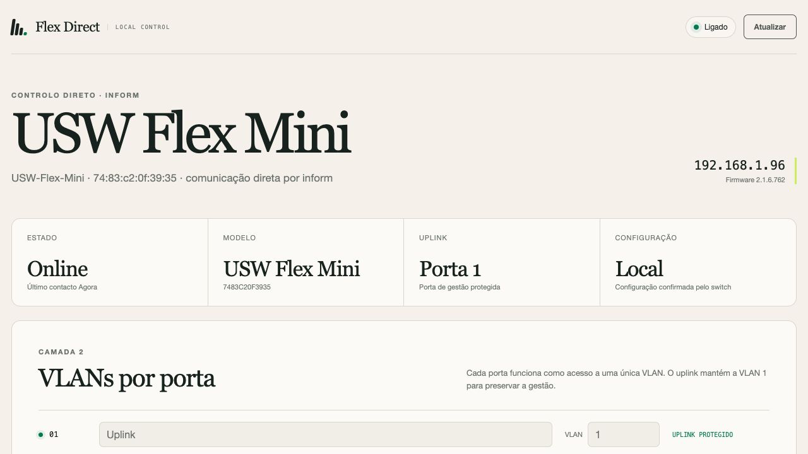
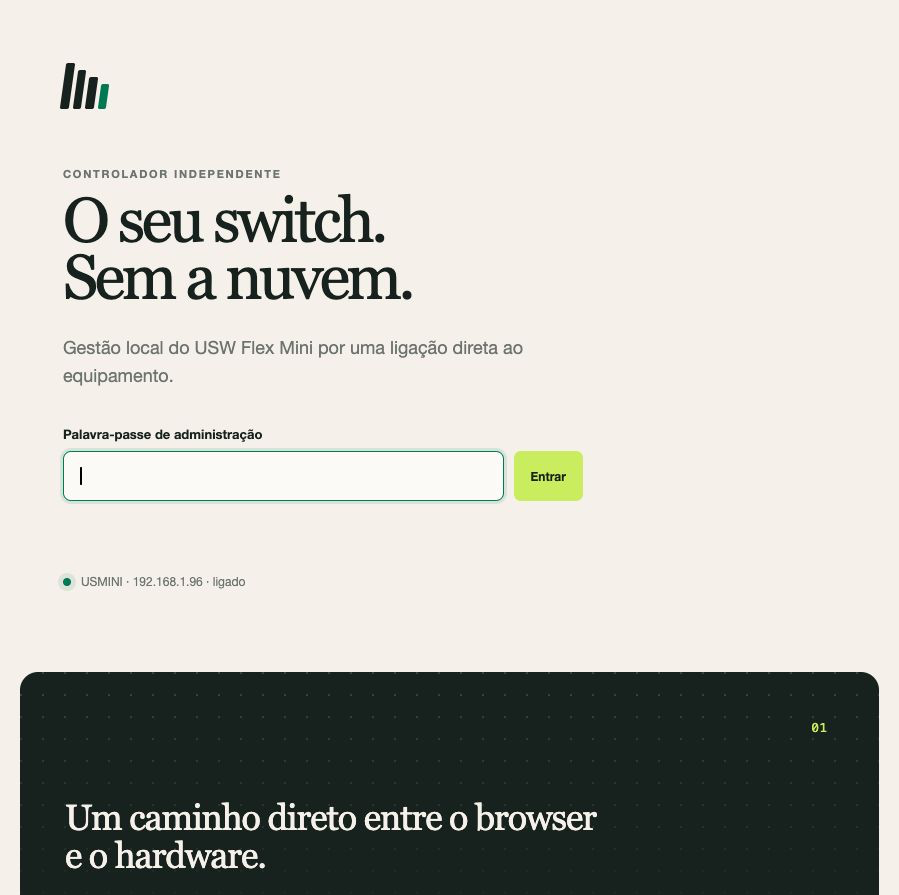
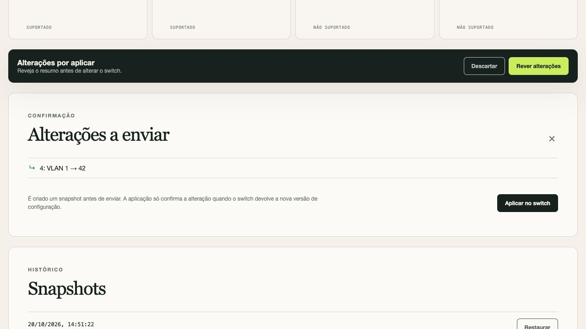
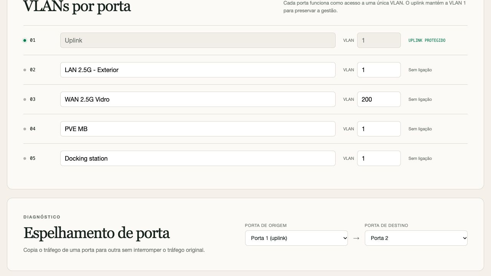

# Flex Direct

Gestão local, experimental e independente do **Ubiquiti USW Flex Mini**. A aplicação fala diretamente com o switch pelo protocolo `inform`, sem UniFi Network, sem conta ui.com e sem uma consola ligada ao equipamento.



O objetivo é simples: o switch e um pequeno serviço local passam a ser suficientes para gerir VLANs de acesso por porta e port mirroring. O tráfego de rede normal continua a ser comutado pelo próprio hardware.

> **Estado:** projeto experimental, validado contra um USW Flex Mini com firmware `2.1.6.762`. Não é um produto oficial da Ubiquiti. Faça uma cópia de `data/` antes de experimentar noutro equipamento ou firmware.

## O que já funciona

- VLAN de acesso (`PVID`) e nome por porta;
- uma sessão de port mirroring, escolhendo origem e destino;
- proteção da porta de uplink contra alterações que possam cortar a gestão;
- pré-visualização das alterações antes de as enviar;
- confirmação da configuração a partir do `cfgversion` devolvido pelo switch;
- snapshot automático antes de cada aplicação e reposição de um snapshot;
- autenticação local, cookie `HttpOnly`, proteção CSRF e limite de tentativas de entrada;
- adoção inicial de um switch de fábrica e rotação para uma chave própria;
- Docker Compose e testes de protocolo, política e integração.

## Limites reais deste modelo

O USW Flex Mini não é um switch gerível de gama completa. Nas versões testadas:

| Função | Estado |
|---|---|
| VLAN de acesso por porta | Suportado |
| Nome de porta | Suportado |
| Port mirroring | Uma sessão |
| STP / RSTP | Não implementado pelo equipamento |
| IGMP snooping configurável | Não disponível |
| VLANs marcadas / trunk | Rejeitadas pelo equipamento |
| PoE | Não existe neste modelo |
| Flash de firmware alternativo | Fora do âmbito |

O projeto não tenta simular funcionalidades que o hardware não oferece. Também não implementa a descoberta UDP do controlador: o switch tem de ser encaminhado para o URL de `inform` da aplicação.

## Como funciona

```text
Browser  ->  Flex Direct (Docker)  <-TNBU/inform-  USW Flex Mini
                    |
                    +-> data/state.json, snapshots e auditoria
```

O switch envia `POST /inform` com um envelope `TNBU` autenticado. A aplicação mantém o estado, prepara um novo `system_cfg` e `mgmt_cfg`, e só considera a operação concluída quando o equipamento regressa com o novo `cfgversion`.

No firmware validado, o switch usa AES-128-GCM. As respostas do controlador seguem sem compressão; esta foi uma diferença importante em relação a implementações genéricas do protocolo. A aplicação aceita ainda informes AES-CBC e compressão zlib na receção.

## Instalação rápida

Requisitos: Docker com Compose. Para desenvolvimento, Node.js 20 ou superior; não há dependências npm externas.

```sh
git clone https://github.com/0raculo/usw-flex-mini-direct.git
cd usw-flex-mini-direct
cp .env.example .env
```

Edite `.env`:

```dotenv
ADMIN_PASSWORD=uma-palavra-passe-longa-e-aleatoria
INFORM_URL=http://endereco-do-servidor:8789/inform
SWITCH_MAC=
AUTO_ADOPT=0
```

`INFORM_URL` tem de ser alcançável **pelo switch**, não apenas pelo browser. Se o serviço estiver na mesma rede que o switch, use diretamente o IP e a porta publicada. Se estiver noutra rede, coloque um relay ou uma regra de encaminhamento no caminho.

Arranque:

```sh
docker compose up -d --build
curl http://127.0.0.1:8789/api/health
```

Abra `http://127.0.0.1:8789` e entre com `ADMIN_PASSWORD`.

Para desenvolvimento:

```sh
npm test
ADMIN_PASSWORD='uma-palavra-passe-longa-e-aleatoria' \
INFORM_URL='http://127.0.0.1:8080/inform' \
npm start
```

## Encaminhar o switch para a aplicação

Antes de gerir o equipamento, é preciso fazê-lo enviar os informes para `INFORM_URL`. Dependendo da instalação, isso pode ser feito com uma das opções seguintes:

- DHCP option 43 ou configuração equivalente do servidor DHCP para anunciar o controlador;
- DNS local do nome usado pelo equipamento, apontado para a aplicação;
- alteração única do *Inform Host Override* num controlador UniFi já existente, antes do cutover.

Depois de o primeiro inform chegar, a aplicação pode adotar o switch e gravar o novo URL de gestão no próprio equipamento. A partir daí, o UniFi Network deixa de ser necessário.

Para um switch que já pertence a outro controlador, a chave `inform` existente pode ser fornecida em `BOOTSTRAP_KEY_FILE` apenas durante a migração. Se o equipamento estiver de fábrica, a aplicação aceita a chave pública por omissão e entrega uma chave própria durante a adoção. Guarde `data/state.json`: é aí que fica a chave definitiva do switch.

Use `SWITCH_MAC` para autorizar um equipamento específico. A aplicação recusa informes de outros MACs.

### Relay entre sub-redes

O switch testado está na LAN `192.168.1.0/24` e a aplicação em `192.168.69.0/24`. O URL gravado no switch é `http://192.168.1.22:8080/inform`; um relay TCP encaminha-o para `192.168.69.176:8789`.

Exemplo de unit systemd (substitua os endereços):

```ini
[Unit]
Description=USW Flex Mini Direct inform relay
Wants=network-online.target
After=network-online.target

[Service]
Type=simple
DynamicUser=yes
ExecStart=/usr/bin/socat TCP4-LISTEN:8080,bind=192.168.1.22,range=192.168.1.96/32,reuseaddr,fork TCP4:192.168.69.176:8789
Restart=on-failure
RestartSec=5
NoNewPrivileges=yes
PrivateTmp=yes
ProtectSystem=strict
ProtectHome=yes

[Install]
WantedBy=multi-user.target
```

O `range=` restringe a origem ao IP do switch. Uma reserva DHCP ou uma regra de firewall também deve fixar esse endereço. O relay só transporta os informes; não altera o encaminhamento normal das portas.

## API local

A interface usa uma API JSON no mesmo processo. As rotas principais são:

| Método e rota | Função |
|---|---|
| `GET /api/health` | Estado básico do serviço |
| `GET /api/status` | Identidade e contacto recente do switch |
| `POST /api/login` | Cria a sessão e devolve o token CSRF |
| `GET /api/state` | Estado completo, portas, snapshots e operação |
| `POST /api/preview` | Valida um rascunho e lista as alterações |
| `POST /api/apply` | Aplica um rascunho previamente revisto |
| `POST /api/snapshots/:id/restore` | Coloca um snapshot em fila |

Depois do login, os pedidos usam o cookie de sessão e o cabeçalho `X-CSRF-Token`. A API não tem autenticação por token de longa duração e não deve ser tratada como interface pública estável. O `/inform` é um endpoint do protocolo do switch, não uma API administrativa.

## Interface



O painel mostra o modelo, firmware, último contacto, estado das portas e a versão de configuração confirmada pelo switch.



Qualquer alteração passa por uma revisão. A aplicação cria primeiro um snapshot e só envia depois da confirmação. Um erro ou uma resposta ausente mantém a operação como pendente, em vez de a apresentar como aplicada.



O mirroring foi exercitado no hardware e reposto no fim do teste. A porta de uplink não pode ser usada como destino de mirroring. As capturas são de uma instalação real; não mostram palavras-passe nem a chave de autenticação do switch.

## Segurança e dados locais

A aplicação não envia telemetria e não contacta ui.com. O volume `data/` contém material sensível:

- `state.json`: configuração, identidade do switch e chave de autenticação;
- `session-secret`: segredo usado para assinar sessões;
- `snapshots/`: cópias das configurações antes de aplicar;
- `audit.jsonl`: eventos de login, fila, envio e reposição.

Mantenha permissões restritas (`0700` na pasta, `0600` nos ficheiros). Não publique `data/` num repositório nem em anexos. Faça backup conjunto de `state.json` e `snapshots/`.

O serviço usa HTTP na rede local. Para o expor fora de uma LAN ou VPN de confiança, coloque-o atrás de um proxy com TLS e autenticação adicional. Restrinja a porta 8789 à rede de gestão. A palavra-passe tem de ter pelo menos 12 caracteres; o cookie de sessão é `HttpOnly` e `SameSite=Strict`, e as escritas exigem CSRF.

## Recuperação

Uma falha da aplicação **não interrompe o tráfego que o switch já está a comutar**. A configuração de switching fica no equipamento; perde-se temporariamente a capacidade de a alterar.

1. Confirme que o contentor está ativo com `docker compose ps` e que `/api/health` responde.
2. Confirme o relay e o IP do switch. Se o IP DHCP mudou, atualize a reserva e o filtro do relay.
3. Se a aplicação perdeu o estado, restaure `data/state.json` e `data/snapshots/` de uma cópia de segurança.
4. Se o URL de inform ou a chave se perderem, restaure a cópia de segurança ou volte a encaminhar o switch para a aplicação. O reset físico deve ser o último recurso, porque apaga a configuração de gestão.

Os snapshots são apenas de configuração de portas. Não incluem firmware, credenciais do UniFi ou outros dados do antigo controlador.

## Testes e validação

`npm test` executa testes de codificação/descodificação TNBU, política de portas, proteção do uplink e dois ciclos HTTP completos: aplicação de mirroring seguida do inform de confirmação, e adoção de um switch de fábrica com entrega de uma chave própria.

No equipamento de referência foram validados manualmente:

- alteração e reposição de VLAN;
- ativação e remoção de mirroring;
- confirmação de `cfgversion`;
- reposição por snapshot;
- reinício do switch e recuperação do inform através do relay;
- arranque do serviço com o switch já a comunicar diretamente.

Depois dos testes, o switch ficou sem mirroring ativo e com a configuração original reposta.

## Referências

- [Ubiquiti USW Flex Mini — downloads e firmware](https://ui.com/download/software/usw-flex-mini)
- [morluto/rea](https://github.com/morluto/rea) — ferramentas de análise e engenharia inversa que ajudaram a investigação;
- [finngineering/usw-flex-mini](https://github.com/finngineering/usw-flex-mini) — notas de hardware e mirroring;
- [datasheet do USW Flex Mini](https://dl.ui.com/ds/usw-flex-mini_ds.pdf).

O protocolo foi implementado a partir de observação do equipamento e documentação pública de inform/TNBU. Este projeto não é afiliado à Ubiquiti. Licença MIT; consulte [LICENSE](LICENSE).
