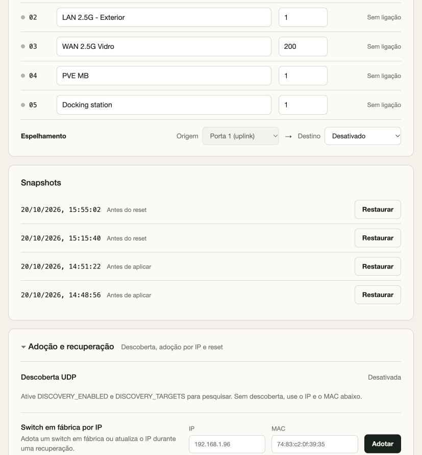
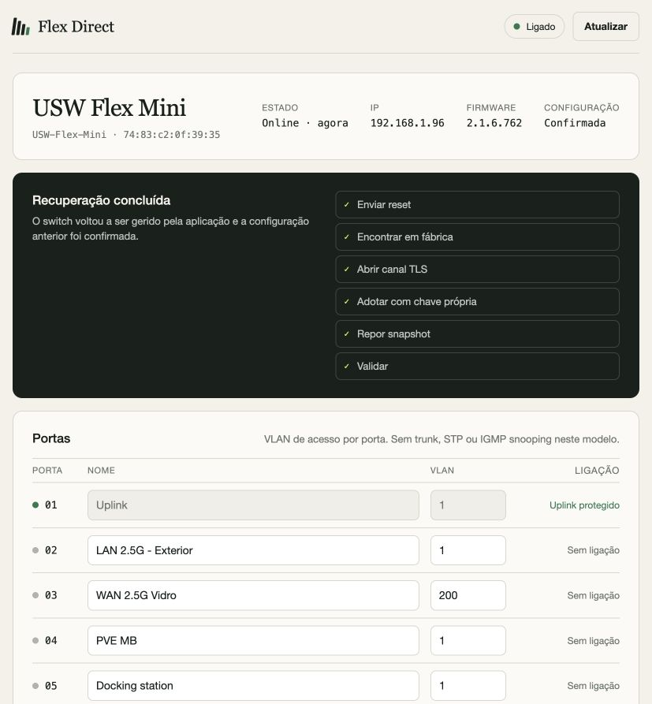

# Flex Direct

Gestão local, experimental e independente do **Ubiquiti USW Flex Mini**. A aplicação fala diretamente com o switch pelo protocolo de inform e por um canal de provisionamento TLS exposto temporariamente no firmware de fábrica.

O projeto não usa uma conta ui.com, uma consola ligada ao switch ou uma instância UniFi Network. O switch e esta aplicação são os componentes necessários para gerir VLANs de acesso por porta e port mirroring. Quando estão em sub-redes diferentes, basta transportar os informes TCP; a adoção de um switch de fábrica pode ser iniciada diretamente pelo IP e MAC.

> **Estado validado:** USW Flex Mini com firmware 2.1.6.762. O ciclo de snapshot, reset, TLS, adoção com chave própria e reposição foi validado no hardware. A recuperação sem anúncio UDP usa o último IP guardado e tem teste de integração próprio.

## O que funciona

- adoção manual por IP e MAC, sem depender de broadcast ou consola;
- recuperação pelo último IP guardado quando o switch não envia anúncio UDP;
- descoberta UDP opcional e desativada no deployment de referência;
- identificação por MAC, IP, modelo, firmware e estado de fábrica;
- adoção de um switch já em estado de fábrica, sem ui.com nem consola;
- reset de fábrica remoto de um switch atualmente gerido pela aplicação;
- snapshot automático antes do reset;
- recovery pelo último endereço, ou por IP/MAC indicado manualmente, depois do reboot;
- troca da chave pública de fábrica por uma chave privada própria;
- reposição automática do snapshot e confirmação pelo cfgversion devolvido pelo switch;
- VLAN de acesso (PVID) e nome por porta;
- uma sessão de port mirroring;
- proteção da porta de uplink;
- pré-visualização, snapshots e histórico de alterações;
- autenticação local, cookie HttpOnly, proteção CSRF e limite de tentativas.

## Independência da consola UniFi

A aplicação não contacta ui.com nem depende de uma instância UniFi Network. O fluxo de recuperação usa três mecanismos locais do próprio firmware:

1. endereço IP e MAC conhecidos, usados para contactar diretamente um switch em fábrica;
2. resposta inform cifrada, usada para gerir o equipamento e enviar o pedido de reset;
3. ligação TLS JSON na porta 22 do firmware de fábrica, usada uma única vez para indicar o URL de gestão e a chave pública de adoção.

Não é necessário instalar ou manter um controlador UniFi para operar o projeto. O único relay usado no deployment de referência transporta os informes TCP entre sub-redes; não é um componente de gestão.

## Arquitetura

    Browser
       |
       v
    Flex Direct (Docker)  <---- inform TNBU ----  USW Flex Mini
       |                          |
       +---- data/state.json, snapshots e auditoria

O switch envia um envelope TNBU autenticado para o endpoint de inform. A aplicação prepara a configuração de gestão, entrega um novo system_cfg quando necessário e só apresenta uma alteração como aplicada quando o equipamento regressa com o cfgversion esperado.

## Início rápido

Requisitos: Docker com Compose. Para desenvolvimento, Node.js 20 ou superior; o projeto não tem dependências npm externas.

    git clone https://github.com/0raculo/usw-flex-mini-direct.git
    cd usw-flex-mini-direct
    cp .env.example .env

Exemplo de configuração:

    ADMIN_PASSWORD=uma-palavra-passe-longa-e-aleatoria
    INFORM_URL=http://192.168.1.22:8080/inform
    SWITCH_MAC=74:83:c2:0f:39:35
    AUTO_ADOPT=0
    DISCOVERY_ENABLED=0
    DISCOVERY_TARGETS=
    DISCOVERY_LISTEN_ENABLED=0
    DISCOVERY_LISTEN_PORT=10001
    DISCOVERY_LISTEN_PUBLISH=10002

O INFORM_URL tem de ser alcançável pelo switch. A aplicação publica a interface em 8789/TCP. A descoberta UDP é opcional e está desligada por omissão; para a usar numa LAN acessível, defina DISCOVERY_ENABLED=1, DISCOVERY_TARGETS e o recetor passivo.

    docker compose up -d --build
    curl http://127.0.0.1:8789/api/health

Abra http://127.0.0.1:8789 e entre com ADMIN_PASSWORD.

Para desenvolvimento:

    npm test
    ADMIN_PASSWORD='uma-palavra-passe-longa-e-aleatoria' \
    INFORM_URL='http://127.0.0.1:8080/inform' \
    npm start

## Rede entre sub-redes

O switch validado está em 192.168.1.0/24 e a aplicação em 192.168.69.0/24. O relay de informes TCP continua necessário para a gestão normal. O antigo relay de anúncios UDP foi desativado: não é necessário para a gestão nem para a recuperação pelo último IP. O limite é que a aplicação deixa de descobrir automaticamente um novo IP anunciado por broadcast noutra sub-rede.

Relay dos informes no host 192.168.1.22:

    [Unit]
    Description=USW Flex Mini inform relay
    Wants=network-online.target
    After=network-online.target

    [Service]
    Type=simple
    DynamicUser=yes
    ExecStart=/usr/bin/socat TCP4-LISTEN:8080,bind=192.168.1.22,range=192.168.1.96/32,reuseaddr,fork TCP4:192.168.69.176:8789
    Restart=on-failure
    RestartSec=5
    NoNewPrivileges=yes
    PrivateTmp=yes
    ProtectSystem=strict
    ProtectHome=yes

    [Install]
    WantedBy=multi-user.target

O unit completo do relay de informes está em deploy/usw-flex-mini-direct-relay.service. O antigo unit de descoberta foi removido do repositório.

## Adotar um switch já de fábrica

1. Com o switch em estado de fábrica e acessível por IP, abra **Descobrir e recuperar**.
2. Preencha o IP e o MAC no formulário **Switch em fábrica já visível por IP** e confirme.
3. A aplicação abre diretamente o canal TLS JSON na porta 22 e entrega o INFORM_URL.
4. O primeiro inform de fábrica é autenticado com a chave pública do firmware.
5. A aplicação responde com uma chave própria e confirma a adoção no inform seguinte.

A descoberta UDP continua disponível como funcionalidade opcional, mas não é necessária. Um switch que já pertença a outro controlador não pode ser adotado desta forma sem uma chave compatível.

Durante uma recuperação, o mesmo formulário aceita um novo IP para o MAC já em recuperação e reinicia as tentativas de abertura do canal TLS.

O estado de recuperação fica visível na interface e é persistido em data/state.json. Fechar o browser não interrompe o processo.

## Reset com recuperação automática

A ação **Reset e recuperar** exige que o switch esteja atualmente gerido pela aplicação e online. Não é possível autenticar o pedido de reset num switch cuja chave ou estado local se perderam.

1. A aplicação cria um snapshot com o motivo before-factory-reset.
2. No inform seguinte envia o comando setdefault autenticado.
3. O switch reinicia e volta ao estado de fábrica.
4. A aplicação procura o MAC nos anúncios, se a descoberta estiver ligada; sem anúncio, tenta o último IP guardado após RECOVERY_SAVED_ADDRESS_DELAY_MS.
5. Entrega o URL de gestão pelo canal TLS de fábrica.
6. Recebe o primeiro inform com a chave pública e gera uma chave privada própria.
7. Confirma a adoção no inform seguinte.
8. Envia o snapshot anterior e só conclui quando o cfgversion do snapshot é confirmado.

O ciclo real de validação terminou com o switch online, adotado por esta aplicação, com chave de fábrica desativada, firmware 2.1.6.762 e a configuração anterior restaurada.

## Interface

As capturas são de uma instalação real e não mostram palavras-passe nem a chave de autenticação do switch.

## API local

A interface usa uma API JSON no mesmo processo. Depois do login, os pedidos usam o cookie de sessão e o cabeçalho X-CSRF-Token.

| Método e rota | Função |
|---|---|
| GET /api/health | Estado básico do serviço |
| GET /api/status | Identidade e contacto recente do switch |
| POST /api/login | Cria a sessão e devolve o token CSRF |
| GET /api/state | Estado completo, descoberta, recuperação e snapshots |
| POST /api/discovery | Executa uma nova varredura |
| POST /api/adopt | Adota um switch por inform, por resultado de descoberta ou diretamente por IP e MAC |
| POST /api/reset | Cria snapshot e arma reset com recuperação automática |
| POST /api/preview | Valida um rascunho e lista alterações |
| POST /api/apply | Aplica um rascunho previamente revisto |
| POST /api/snapshots/:id/restore | Coloca um snapshot em fila |

O endpoint /inform pertence ao protocolo do switch e não é uma API administrativa. A API local não disponibiliza tokens de longa duração e não deve ser exposta diretamente à Internet.

## Limitações reais

- O reset remoto exige que o switch esteja atualmente gerido por esta aplicação. Um switch cuja chave se perdeu tem de ser encaminhado novamente para o inform ou recuperado a partir de uma cópia de data/.
- Sem descoberta UDP entre sub-redes, um reset só é recuperado automaticamente se o switch mantiver o IP guardado. Se o DHCP mudar o IP, é necessário indicar o novo IP e MAC no formulário de adoção manual.
- Não há upload ou flash de firmware na aplicação. A versão instalada pode ser consultada, mas upgrade continua a exigir um mecanismo externo compatível.
- O USW Flex Mini expõe PVID/VLAN nativa por porta, mas não permite configurar VLANs marcadas ou um modo trunk geral pela aplicação validada.
- STP e RSTP não são configuráveis no hardware validado, apesar de aparecerem em algumas interfaces UniFi.
- IGMP snooping não é configurável neste modelo.
- A investigação de firmware próprio está documentada em [docs/firmware-feasibility.md](docs/firmware-feasibility.md). Nenhum firmware alternativo foi instalado; a falta de recuperação física mantém essa via bloqueada.
- Port mirroring suporta uma sessão e não pode usar a porta de uplink como destino.
- A porta 1 é tratada como uplink protegido para preservar a gestão; o projeto não modifica a sua VLAN nem a usa como destino de mirroring.
- Os snapshots cobrem a configuração de portas. Não incluem firmware, credenciais do antigo controlador, DHCP ou configuração externa da rede.
- O canal de recuperação depende de o firmware de fábrica manter a porta 22/TLS acessível. Não existe fallback por SSH normal no modelo validado.
- O relay de informes está restrito à origem 192.168.1.96/32 no exemplo. Se o DHCP mudar o IP durante um reset, a reserva ou a regra do relay tem de ser atualizada.
- A interface usa HTTP local. Para acesso fora de uma LAN ou VPN de confiança, coloque-a atrás de um proxy TLS com autenticação adicional.

## Segurança e dados locais

O volume data/ contém material sensível:

- state.json: configuração, identidade do switch, chave privada de gestão e estado da recuperação;
- session-secret: segredo usado para assinar sessões;
- snapshots/: cópias das configurações antes de aplicar ou reiniciar;
- audit.jsonl: eventos de login, descoberta, reset, adoção e reposição.

Mantenha permissões restritas, com 0700 na pasta e 0600 nos ficheiros. Não publique data/ no repositório, em anexos ou em logs. Faça backup conjunto de state.json e snapshots/ antes de testes destrutivos.

O fluxo de fábrica usa as credenciais públicas ubnt/ubnt e a chave pública do firmware apenas durante a adoção inicial. A chave privada criada depois nunca aparece na interface, no README ou nos eventos de auditoria.

## Testes

    npm test

A suite atual tem 20 testes e cobre:

- codificação e descodificação TNBU em AES-GCM e AES-CBC;
- política de VLAN e proteção do uplink;
- mirroring e confirmação por cfgversion;
- parser V1/V2 e TLVs de estado de fábrica;
- expansão de CIDR e sondagem UDP unicast;
- recetor passivo de anúncios;
- payload TLS JSON do canal de fábrica;
- parser e validação CRC de imagens USMINI;
- adoção manual por IP/MAC, incluindo validação de endereços;
- ciclo HTTP completo de reset, TLS, adoção, chave própria e reposição do snapshot sem anúncio UDP.

No hardware de referência foram validados manualmente:

- adoção de fábrica pelo endereço IP e MAC, sem relay UDP;
- snapshot antes do reset;
- envio de setdefault e reboot;
- recuperação pelo último IP guardado;
- abertura do canal TLS e primeiro inform com chave de fábrica;
- troca para chave própria e confirmação da adoção;
- reposição do snapshot e cfgversion;
- recuperação do relay de informes;
- estado final online e configurado após o ciclo.

O teste destrutivo completo pode ser repetido contra um switch já gerido com o último IP estável:

    ADMIN_PASSWORD='...' BASE_URL='http://192.168.69.176:8789' npm run smoke

O script cria um snapshot, envia reset, acompanha a recuperação e falha se o estado final não for complete.

## Referências

- [Ubiquiti USW Flex Mini — downloads e firmware](https://ui.com/download/software/usw-flex-mini)
- [morluto/rea](https://github.com/morluto/rea) — ferramentas de análise e engenharia inversa que ajudaram a investigação;
- [lucavb/open-unifi](https://github.com/lucavb/open-unifi) — documentação pública do protocolo inform e do ciclo de vida de reset;
- [HostiFi discovery tool](https://github.com/HostiFi/hostifi-device-discovery-tool-releases) — referência do canal TLS JSON do Flex Mini;
- [finngineering/usw-flex-mini](https://github.com/finngineering/usw-flex-mini) — notas de hardware e mirroring;
- [datasheet do USW Flex Mini](https://dl.ui.com/ds/usw-flex-mini_ds.pdf);
- [RTL8367RB datasheet](https://openwrt.org/_media/media/datasheets/switch/rtl8367rb-cg.pdf);
- [noodlefighter/rtl8367b-api-test](https://github.com/noodlefighter/rtl8367b-api-test) e [zhai-dada/RTL8367-SDK](https://github.com/zhai-dada/RTL8367-SDK) — referências de controlo do switch Realtek, sem código incorporado neste projeto.

O protocolo foi implementado a partir de observação do equipamento e documentação pública. Este projeto não é afiliado à Ubiquiti. Licença MIT; consulte [LICENSE](LICENSE).
